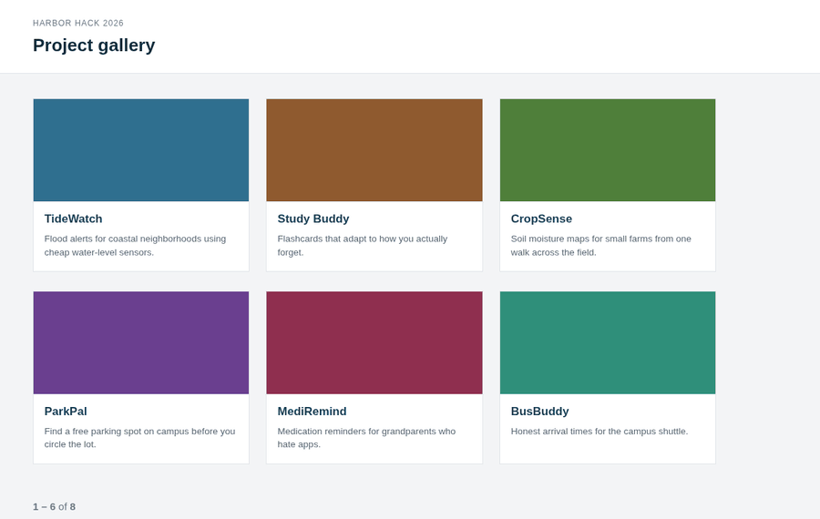
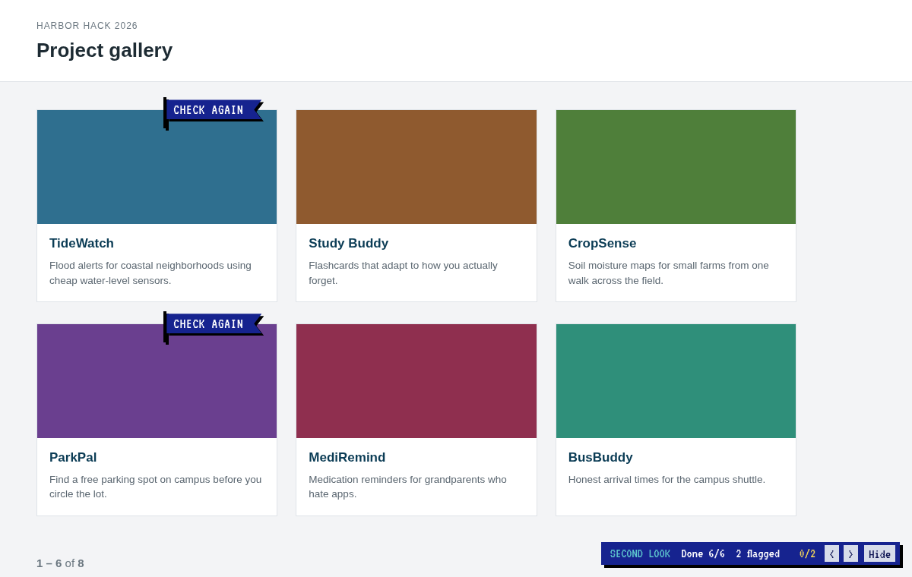
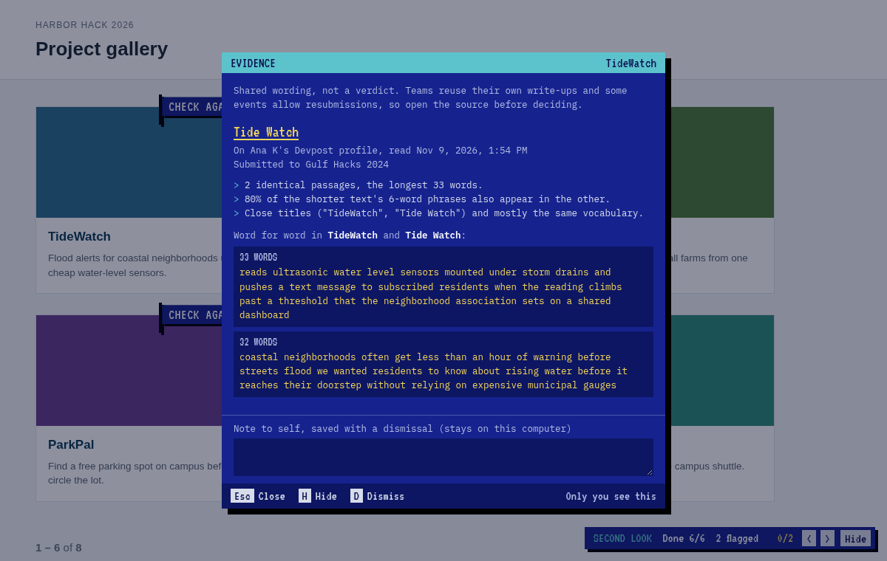
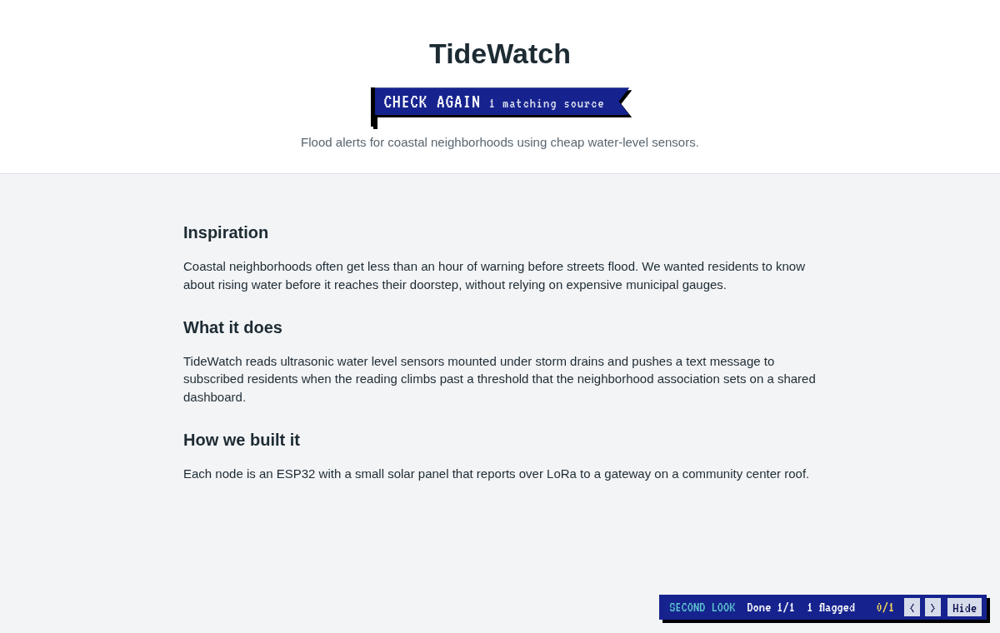
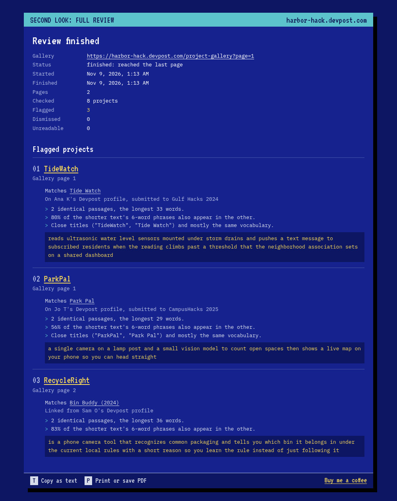
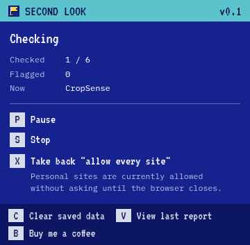

# Second Look

Browser extension for Devpost judges and organizers. It compares each project's write-up with its team members' other public work and puts a **CHECK AGAIN** flag on projects whose wording closely matches something older. Only the person running it sees the flags. A person decides what they mean.

It is not a plagiarism verdict. A match can have an ordinary explanation: a team reusing its own words, a template, or a resubmission the rules allow. The flag says "look at this one", nothing more.



The screenshots and GIF use a made-up hackathon served from local test pages. No real projects or people appear in them.

## How it decides to flag

For each project it reads the project page, every team member's Devpost profile, the member's other projects that look related, and (if you allow it) personal sites linked from those profiles. Then it compares the write-ups text to text.

A project is flagged when at least one of these holds against another page:

- **A long identical run**: 20 or more words in a row are the same.
- **Several identical passages**: 3 or more shared runs of 8+ words.
- **Heavy phrase overlap**: 20% or more of the shorter text's 6-word phrases also appear in the other.
- **Same project, renamed slightly**: titles at least 70% alike *and* mostly the same vocabulary.

Some things never flag on their own:

- A similar title.
- Shared buzzwords.
- Devpost's template headings ("Inspiration", "What it does", ...).
- Phrases that 3 or more projects on the same page share, which are treated as common wording.

Very short write-ups (under 25 content words) only flag on a 15-word identical run.

Every flag comes with its evidence: the matching page and how it was found, when it was read, the hackathon it was submitted to, the reasons in plain words, the identical passages, and anything that couldn't be checked.

## Examples

These cases are made up, but each one is a kind of reuse judges run into. The reasons are copied from what the extension printed for each pair. `tests/similarity.test.js` runs the same text, so they stay accurate.

### Last year's project, entered again

A team submits **Shelf Life** to Riverbend Hacks 2026. One member's Devpost profile lists **ShelfLife**, submitted to a different hackathon a year earlier. The new write-up is the old one minus its last sentence.

> - 2 identical passages, the longest 63 words.
> - 91% of the shorter text's 6-word phrases also appear in the other.
> - Close titles ("ShelfLife", "Shelf Life") and mostly the same vocabulary.

What to check: whether the event allows continuing old projects, and whether the repo has commits from before the start time.

### Built before the weekend

**Lectern** turns recorded lectures into study guides. Nothing on Devpost matches. One member's profile links a personal site, and a post there from 2025 describes the same app.

> - 5 identical passages, the longest 25 words.
> - 38% of the shorter text's 6-word phrases also appear in the other.

The titles have nothing in common, so title checks alone would miss this. What to check: the date on the post, and whether the demo shows anything the post doesn't.

### Reworded, same project

**FindFido** maps lost-pet posts for a neighbourhood. A member's older project, **StrayMap**, does the same thing. The new text swaps the tech stack and some words ("brings" for "collects", "anyone" for "a volunteer") but keeps most phrases.

> - 4 identical passages, the longest 17 words.
> - 46% of the shorter text's 6-word phrases also appear in the other.

No single run reaches 20 words, so the long-run rule doesn't fire. The repeated shorter runs and the phrase overlap do.

### Not flagged: same idea, new work

A member who built **RideShare Campus** (carpools for students) enters **RideShare Commute** (a Slack bot for office carpools). The titles are 62% alike and both talk about carpools. They share no 8-word run and no 6-word phrases, so there is no flag. Reusing a name or an idea is normal.

## Screenshots

| | |
| --- | --- |
|  |  |
| Gallery page after a check. `0/2 < >` jumps between flags. | The evidence behind a flag. |
|  |  |
| A project page opened after a gallery run. The flag comes from the saved result. | Report at the end of a full gallery review. |



## Install

Build it, then load it unpacked:

```sh
npm install
npm run build
```

- **Chrome / Edge (121+)**: `chrome://extensions` → Developer mode → Load unpacked → `dist/chrome`.
- **Firefox / Zen (128+)**: `about:debugging#/runtime/this-firefox` → Load Temporary Add-on → `dist/firefox/manifest.json`.

## Use

Open the menu on a supported page. Every action has a key.

| Key | Action |
| --- | --- |
| `1` | Check this page. Tick "Also check pages I open later in this tab" to keep it on. |
| `2` | Check every page of this gallery. Checks a page, waits 2 s, follows Devpost's "next" link, and stops after the last page. Then it opens a report you can copy (`T`) or save as PDF (`P`). |
| `P` / `R` / `S` | Pause, resume, stop. |
| `G` | Check again, ignoring results saved earlier this session. |
| `C` | Clear saved data. Needs a second press. |
| `V` | Open the last full-review report. |

Supported pages:
- hackathon galleries (`/project-gallery`, `/submissions`, and filtered `/submissions/search` views);
- the `devpost.com/software` listings;
- single project pages.

Everything else is refused.

### Flags

- The status bar sits in the bottom right corner. If the window runs under the taskbar, it moves up until it's visible.
- It shows the number of flags in the **whole gallery**, counting every page checked this session.
- `<` and `>` step through those flags like find-next. If the next flag is on another page, it goes to that page and scrolls to the project. During a full review, that page opens in a second tab so the review keeps going.
- Clicking a flag opens the evidence. `Esc` closes, `H` hides the flag for the session, and `D` dismisses it with an optional note. A dismissed flag comes back only if a new matching source turns up.
- Project pages get a large flag under the title.

## Permissions

All site access is optional and asked for when needed.

| Permission | Why |
| --- | --- |
| `devpost.com`, `*.devpost.com` | Read project and profile pages. Asked the first time you start a check. |
| `https://*/*` | Ask for one personal site at a time, or, if you choose, every site until the browser closes. |
| `scripting`, `activeTab` | Inject the page script on demand. Nothing runs until you start a check. |
| `storage` | Dismissals and notes on disk. Results and reports for the browser session only. |

When a personal site needs permission, a small window lists the sites:
- `A` allows those sites.
- `E` allows every site until the browser closes. The browser warns "all sites", but only links found on Devpost profiles are opened. The grant is removed on the next browser start, or right away with `C` or `X` in the menu.
- `N` skips them for the session.

## Data handling

- Everything runs in the browser: no server, no analytics, no accounts.
- Requests go without cookies, so nothing behind your Devpost login is read.
- What is saved on disk is limited to dismissals: the project URL, the matching source URLs, your note and the time. Everything else is cleared when the browser closes.
- Page content is treated as untrusted. It is parsed with `DOMParser` and inserted only as text. Flags live in closed shadow roots that Devpost's scripts can't read.
- Nothing is posted to Devpost or sent to anyone.

## Rate limits

- Requests to one site go one at a time:
  - at least 1 s apart on Devpost and 2 s elsewhere;
  - after a `429` or `503`, it waits for `Retry-After` and slows down for that site.
- `robots.txt` is honoured. If it can't be fetched, the site isn't read.
- Caps:
  - 80 projects per page;
  - 8 members per project;
  - 3 profile links per member;
  - 40 pages per full review;
  - 8000 requests per browser session.

A project takes about 4 to 6 requests, so a 24-project page takes roughly 1 to 2 minutes.

## Limitations

- **Cloudflare.** If Cloudflare challenges a request, that page counts as unreadable. The extension never tries to get around the check.
- **Devpost's markup.** The extension depends on the current page structure. After a redesign it will report "layout not recognized" until `src/lib/extract.js` is updated.
- **Text only.** It compares wording, not code, images or video. It can't tell which text was written first.
- **Profiles.** It reads only the first page of each member's Devpost projects.

## Develop

Needs Node 20+.

```sh
npm test              # node:test with synthetic HTML fixtures, no network
npm run build         # dist/chrome and dist/firefox
npm run lint:firefox
```

`web-ext lint` gives one warning, `UNSAFE_VAR_ASSIGNMENT`, on the `import()` in `content/loader.js`. Its argument is always `runtime.getURL('content/main.js')`.

```
src/
  background.js      request queue, permissions, injection, saved results, full-review runs
  content/           page UI: flags, evidence panel, status bar
  popup/             extension menu
  permissions/       window that asks about personal sites
  report/            full-review report
  lib/
    similarity.js    flag rules and reasons (THRESHOLDS)
    analyzer.js      per-project pipeline and limits (LIMITS)
    extract.js       Devpost and portfolio page parsing
    fetcher.js       robots.txt, retries, budget, cache
    flag-nav.js      flag order across gallery pages
tests/               test suites and fixtures
scripts/             build and icon generation
```

The fonts are VT323 and IBM Plex Mono, bundled under the SIL Open Font License. The icon is drawn on a 16x16 grid in `scripts/icons.py`.

## Support

Second Look is free. If it saved you time, you can [buy me a coffee](https://buymeacoffee.com/walilambere).
